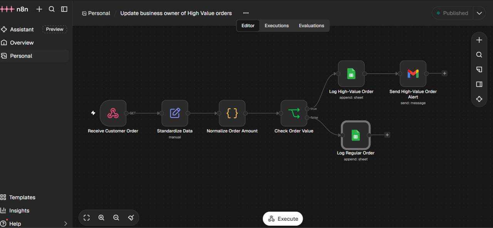
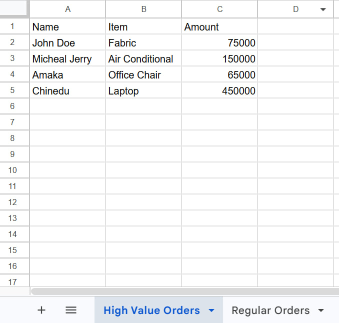
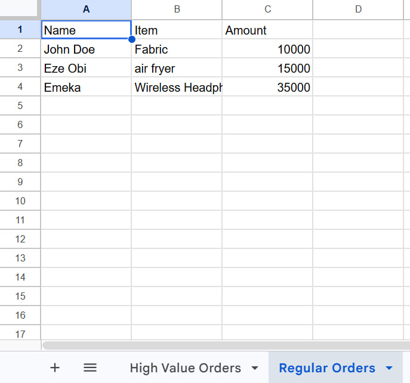
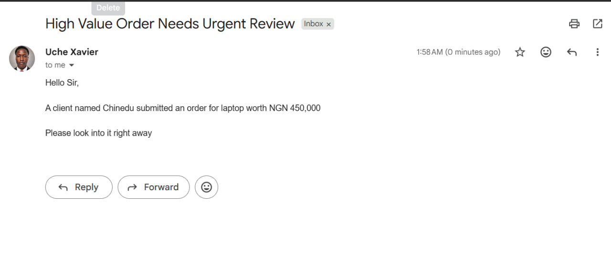

# Automated Order Classification & High-Value Alert System

An n8n automation workflow that classifies incoming orders by value, records them in separate Google Sheets, and automatically alerts the business owner or team when a high-value order requires attention.

**Project Type:** Personal Demonstration Project  
**Status:** Built and successfully tested  
**Automation Platform:** n8n

## 1. Business Problem

Businesses receive orders with different monetary values, but manually reviewing every order can make it difficult to identify high-value opportunities that deserve immediate attention.

This workflow demonstrates how businesses can automate order classification, maintain organized records, and receive timely internal notifications for high-value orders.

## 2. Solution

The workflow receives incoming order information through a webhook, processes the data, and evaluates the order amount against a configurable threshold.

- High-value orders are recorded in a dedicated Google Sheet and trigger an email notification through Gmail.
- Regular orders are recorded in a separate Google Sheet without triggering an email notification.

For this demonstration, the high-value threshold is **NGN 50,000**.

## 3. Technology Stack

- **n8n:** Workflow orchestration.
- **Webhook:** Receives incoming order data.
- **Edit Fields:** Prepares incoming data.
- **JavaScript:** Normalizes order amounts.
- **IF Node:** Evaluates order value and controls workflow routing.
- **Google Sheets:** Stores regular and high-value orders separately.
- **Gmail:** Sends internal high-value order notifications.

## 4. Workflow Architecture

Webhook → Edit Fields → Code → IF Node

**High-value branch (amount > NGN 50,000):**

Google Sheets (High-Value Orders) → Gmail Notification

**Regular-order branch (amount ≤ NGN 50,000):**

Google Sheets (Regular Orders)

Both Google Sheets integrations use the Append Row operation to preserve incoming order records.

## 5. Incoming Data Structure

The workflow accepts three primary fields:

| Field | Description |
|---|---|
| name | Customer name |
| item | Ordered product or service |
| amount | Monetary value of the order |

## 6. Amount Normalization

The JavaScript Code node cleans incoming amount values before they reach the IF node.

It removes currency labels, commas and whitespace, and converts shorthand amounts such as `75k` into numeric values.

```javascript

return $input.all().map(item => {
  let text = String(item.json.amount)
    .toLowerCase()
    .replace(/ngn|,|\s/g, '');

  let number = text.endsWith('k')
    ? parseFloat(text) * 1000
    : parseFloat(text);

  return {
    json: {
      ...item.json,
      amount: number
    }
  };
});

```

This allows the workflow to evaluate monetary values consistently.

## 7. Business Logic

| Order Amount | Classification | Action |
|---|---|---|
| NGN 75,000 | High-value | Save and notify |
| NGN 60,000 | High-value | Save and notify |
| NGN 50,000 | Regular | Save only |
| NGN 30,000 | Regular | Save only |

The comparison uses a strict greater-than condition. An order worth exactly NGN 50,000 does not trigger an alert.

The threshold can be adjusted to reflect a particular business's requirements.

## 8. Email Notification

When a high-value order is received, Gmail sends an internal notification to the business owner or responsible team.

Example notification:

> Hello Sir,
>
> A client named [Customer Name] submitted an order for [Item] worth NGN [Amount].
>
> Please look into it right away.

The customer name, item and formatted order amount are populated dynamically using n8n expressions.

## 9. Testing and Verification

The workflow was executed successfully during testing.

The tested business logic confirms that:

- Orders above NGN 50,000 follow the high-value branch.
- High-value orders are recorded before the notification is sent.
- Orders of NGN 50,000 or below follow the regular-order branch.
- Both branches use Append Row to store order records.

## 10. Current Limitations

- This project is a personal demonstration, not a live client deployment.
- Testing was performed using sample orders.
- The workflow assumes the incoming order amount can be converted into a valid number.
- Input validation and error handling are not yet fully implemented.
- Gmail and Google Sheets require properly configured credentials before business use.

## 11. Potential Improvements

Future improvements could include:

- Input validation and error handling.
- Duplicate order detection.
- Configurable thresholds for different businesses.
- WhatsApp, Slack or Microsoft Teams notifications.
- Execution logging and failure alerts.
- Integration with actual order-management systems.

## 12. Key Skills Demonstrated

- Workflow automation with n8n.
- Webhook integrations.
- JavaScript data transformation.
- Conditional routing and business logic.
- Google Sheets integration.
- Gmail automation.
- Business-process optimization.

## 13. Testing Evidence

The workflow was tested using sample orders to verify both routing paths and the email notification.

### High-Value Order
Orders above NGN 50,000 are recorded in the high-value orders sheet.



### Regular Orders
Orders of NGN 50,000 or below are recorded without triggering an email notification.



### Email Notification
The business owner or team receives an automated Gmail alert when a high-value order is submitted.



---

**Built by Uche Xavier**  
AI Automation & Workflow Engineering
