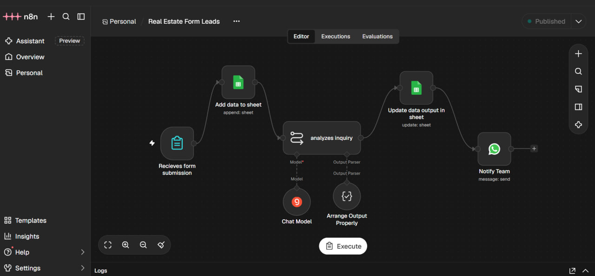
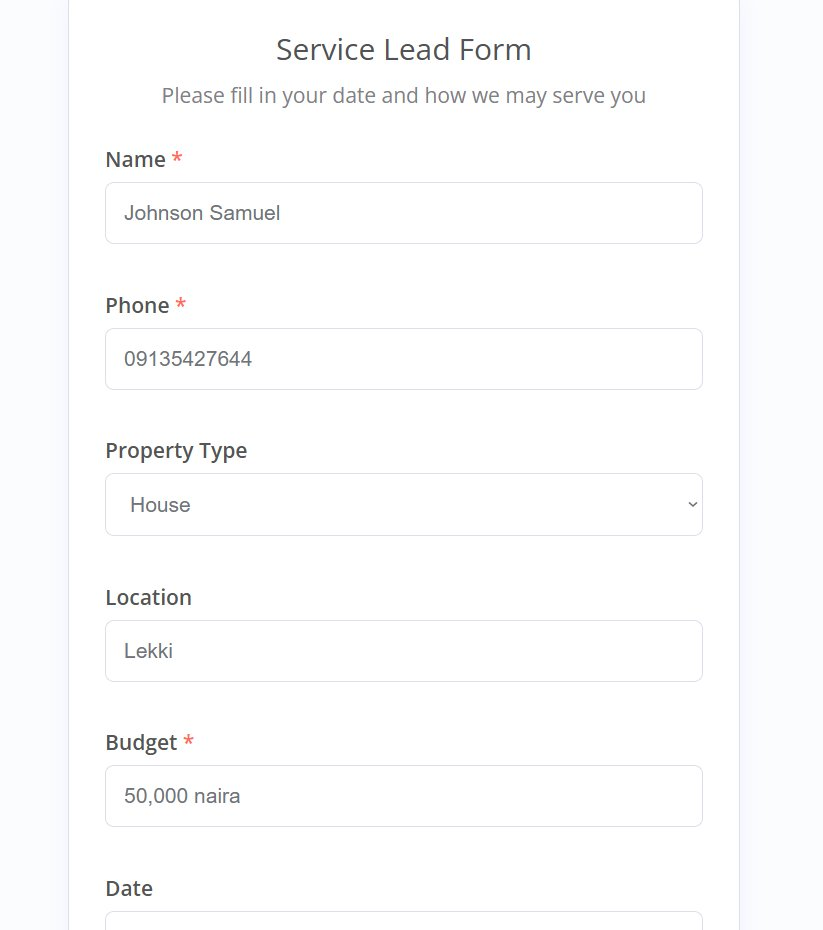
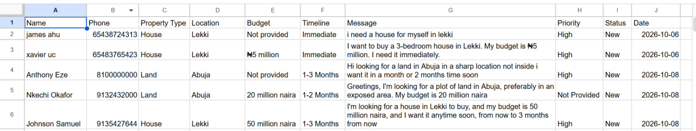
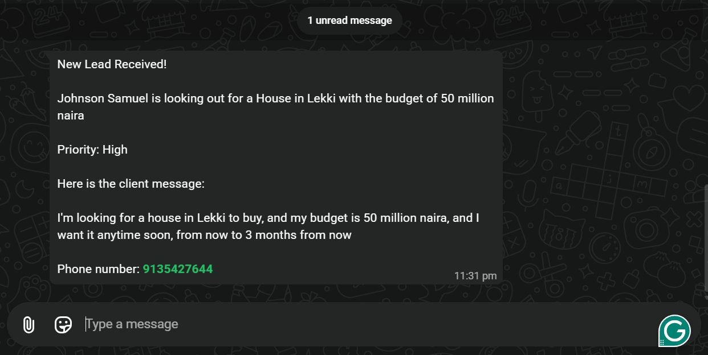

# Real Estate Lead Automation System

## Project Overview

An AI-powered lead management workflow built with n8n to help real estate businesses capture, organize, qualify, and prioritize incoming property enquiries.

The system receives enquiries through a form, stores the original information in Google Sheets, uses AI to extract structured lead details, updates the existing lead record, and sends a WhatsApp notification to the team.

## Business Problem

Real estate teams often receive property enquiries containing incomplete or unstructured information.

Manually reviewing and organizing these enquiries can lead to:

- Delayed responses to potential clients.
- Poor lead organization.
- Difficulty identifying urgent enquiries.
- Time-consuming administrative work.
- Missed opportunities due to inefficient lead handling.

## Solution

This workflow automates the initial lead-processing process using n8n, an AI model, Google Sheets, and the WhatsApp Business Cloud API.

When a prospect submits an enquiry:

1. The form submission triggers the workflow.
2. The original lead information is stored in Google Sheets.
3. An AI model analyzes the enquiry and extracts relevant information.
4. A structured output parser defines the expected JSON format.
5. Google Sheets updates the existing record using the lead's phone number.
6. WhatsApp sends a notification containing the processed lead information to the team.

## Workflow Architecture
### Complete Workflow

**Form Submission → Google Sheets (Append Row) → AI Lead Analysis → Google Sheets (Update Row) → WhatsApp Notification**

### 1. Lead Capture

A form submission webhook receives the prospect's information, including:

- Name
- Phone number
- Original enquiry message
- Submission date

The original information is saved in Google Sheets before AI processing begins.

### 2. AI-Powered Lead Analysis

An AI model analyzes the incoming enquiry using a custom instruction prompt.

It extracts six structured fields:

| Field | Description |
|---|---|
| `lead_intent` | Buyer, Seller, Tenant, Landlord, or Unknown |
| `urgency` | High, Medium, Low, or Unknown |
| `property_type` | Type of property mentioned |
| `location` | Preferred property location |
| `budget` | Stated budget or price range |
| `timeline` | Immediate, 1-3 Months, 3-6 Months, Just Browsing, or Unknown |

The AI prompt instructs the model not to invent missing information and to return Unknown when information cannot be confidently determined.

### 3. Structured Output Parsing

The workflow uses an Output Parser configured with a JSON Example schema.

All six properties are required, helping the AI analysis stage return information in a consistent structure.

### 4. Google Sheets Lead Management

The workflow updates the existing lead record instead of creating a duplicate processed record.

- Spreadsheet: Real Estate Lead Form
- Worksheet: Sheet1
- Operation: Update Row
- Matching column: Phone

The workflow combines the original form information with the AI-extracted fields.

It updates property type, location, budget, timeline, priority, and other lead details while preserving the original enquiry.

The lead status is set to New.

### 5. WhatsApp Team Notification

After the Google Sheets update, the workflow sends a text notification through the WhatsApp Business Cloud API.

The notification includes:

- Lead name
- Property type
- Preferred location
- Budget
- Priority
- Original enquiry message
- Lead phone number

Missing budget or priority values are displayed as Not provided rather than being left blank.

## Technologies Used

- **n8n:** Workflow automation and orchestration.
- **AI Chat Model:** Natural-language lead analysis and information extraction.
- **Structured Output Parser:** Defines the expected JSON structure.
- **Google Sheets:** Lead storage and record management.
- **WhatsApp Business Cloud API:** Team notifications.
- **Webhook Form:** Lead submission trigger.

## Sample Test Case

The workflow was tested using a sample property enquiry.

### Original Enquiry

"I want a land in Aba, with the budget of 7 million and I need feedback soon."

### AI-Extracted Output

| Field | Extracted Value |
|---|---|
| Lead Intent | Buyer |
| Urgency | High |
| Property Type | Land |
| Location | aba |
| Budget | 7 miilion |
| Timeline | Immediate |

### Test Observation

The workflow successfully identified the buyer's intent, property type, location, urgency, and timeline.

The budget was extracted but retained the spelling error from the original message. This highlights an opportunity to improve budget normalization and data validation.

*Note: This is sample test data, not a real customer enquiry.*

## Workflow Evidence

### Lead Capture Form

### Google Sheets Lead Records

### WhatsApp Team Notification

The notification demonstrates how processed lead information is delivered to the team through WhatsApp.

## Business Benefits

- Reduces manual lead-processing work.
- Organizes incoming property enquiries.
- Extracts useful information from natural-language messages.
- Helps teams identify lead urgency.
- Keeps original enquiry information available.
- Improves internal communication through WhatsApp notifications.

## Project Status

**Working demonstration — tested with sample property enquiries.**

The workflow has been tested using Google Sheets and the WhatsApp Business Cloud API test environment. It is a demonstration project and is not presented as a live client deployment.

## Future Improvements

- Improve consistency between urgency and timeline classifications.
- Add automated lead follow-ups.
- Introduce priority-based routing.
- Add workflow error handling and execution monitoring.
- Integrate with real estate CRM platforms.
- Build lead performance reports and dashboards.
- Configure production WhatsApp credentials and deployment.

## Security Notice

This repository documents the project implementation.

API credentials, access tokens, private phone numbers, personal lead information, and other sensitive workflow data must never be published in this repository.
