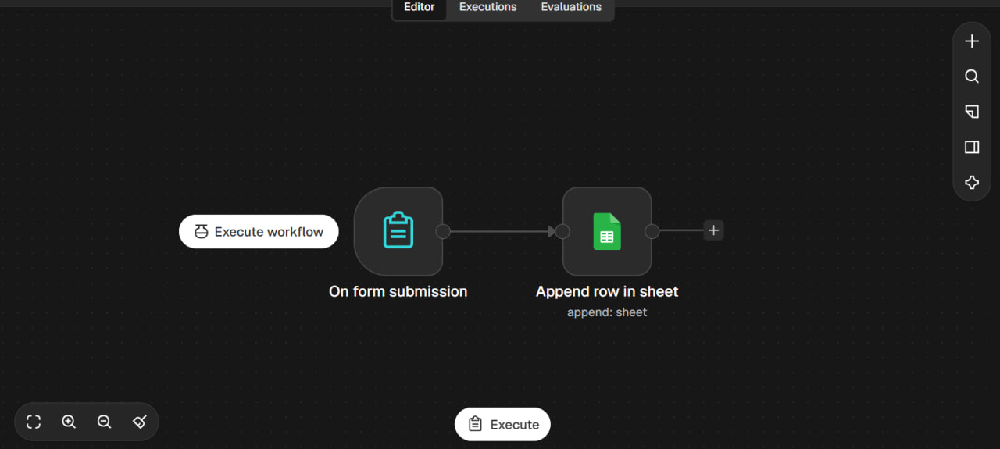
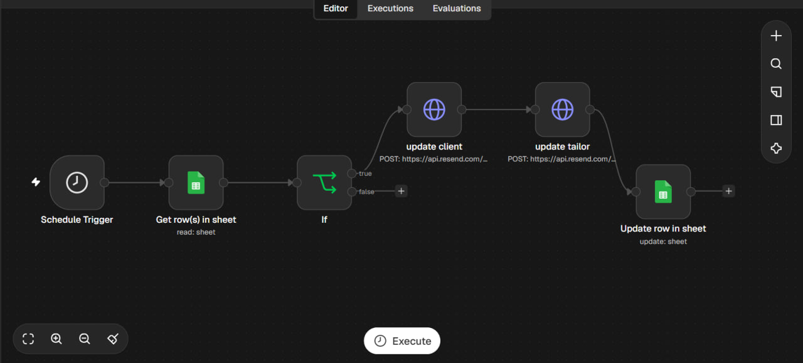
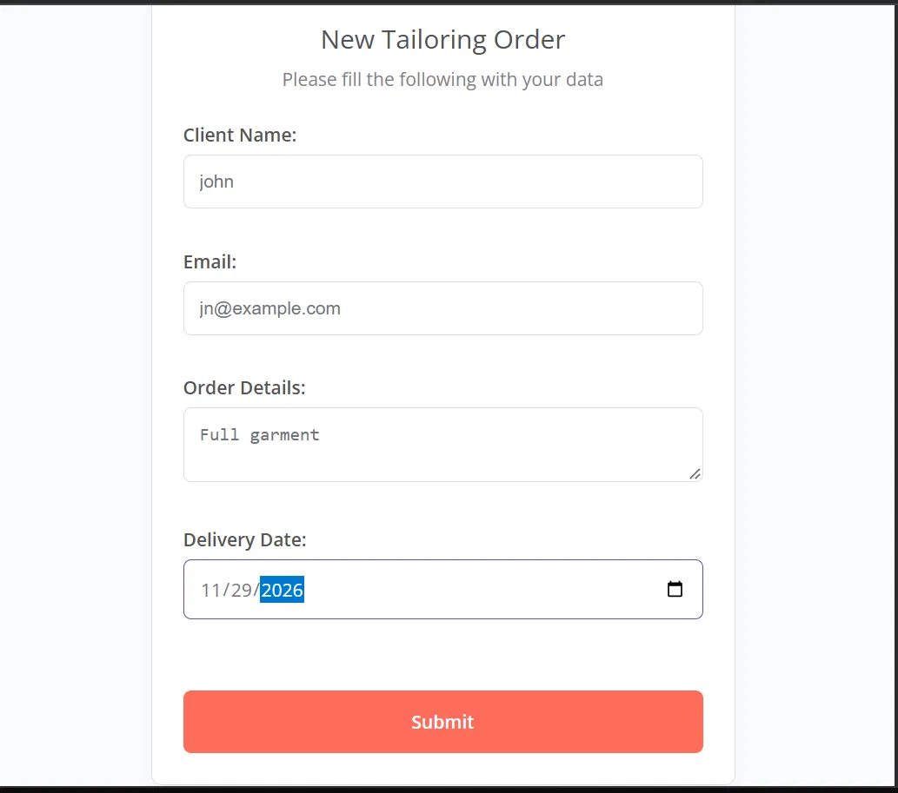
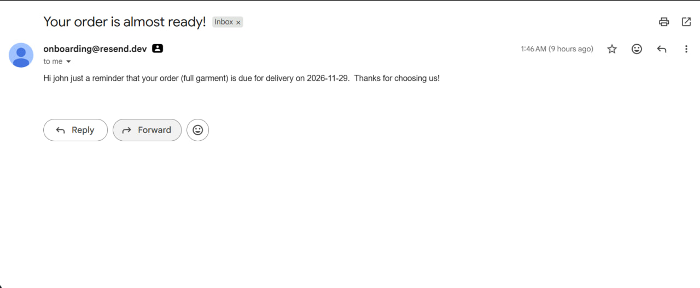
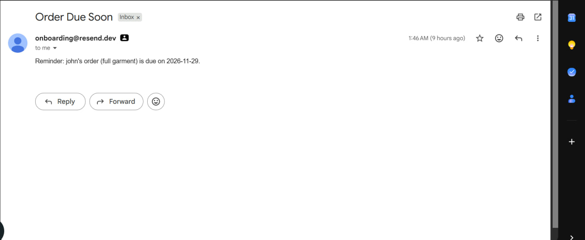
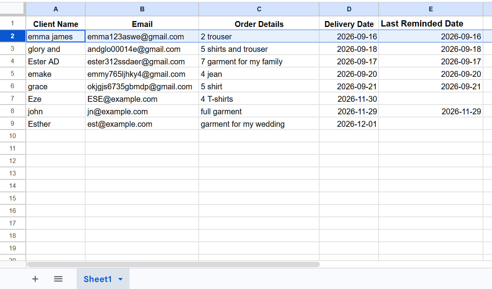

# Tailoring Order Delivery Reminder

Two n8n workflows for a tailoring business. One takes new orders from a web form and saves them to a Google Sheet. The other runs every morning, finds orders close to their delivery date, and emails both the client and the tailor. Each order is reminded once, and again only if its delivery date changes.

**Project Type:** Personal Demonstration Project
**Status:** Working demo, tested with sample orders. Not a live client deployment.
**Automation Platform:** n8n (self-hosted)

## 1. Business Problem

A tailor who tracks orders by hand has to remember every delivery date. Missed dates mean late deliveries and customers who are not told their order is almost ready.

## 2. Solution

- **Workflow 1 (order intake):** a form collects the client's name, email, order details and delivery date, and appends a row to Google Sheets.
- **Workflow 2 (daily reminders):** every morning at 8 AM it reads the sheet, finds orders due within the next three days that have not been reminded for their current delivery date, emails the client and the tailor, and records the reminder in the sheet.

## 3. Technology Stack

- **n8n:** Workflow orchestration.
- **Form Trigger:** Collects new orders.
- **Schedule Trigger:** Runs the reminder check daily at 8 AM.
- **Google Sheets:** Stores orders and the reminder record.
- **If node:** Decides which orders need a reminder.
- **HTTP Request nodes:** Send the client and tailor emails through the Resend email API.
- **Error workflow:** Alerts me when a run fails.

## 4. Workflow Architecture

### Workflow 1: Order intake

On form submission → Append row in sheet

### Workflow 2: Daily reminders

Schedule Trigger (8 AM) → Get row(s) in sheet → If → update client (email) → update tailor (email) → Update row in sheet

Orders that do not pass the If node are left alone and no emails are sent for them.

## 5. The Order Form

Fields: Client Name, Email, Order Details, Delivery Date. Each submission becomes one row in the sheet with Last Reminded Date left empty.

## 6. Business Logic

The If node passes an order when all three conditions are true:

- **Delivery Date is before today + 3 days**, so an order already inside the window still gets caught if a run was missed.
- **Last Reminded Date is not equal to Delivery Date**, so an order already reminded for its current delivery date is not reminded again.
- **Delivery Date is after today**, so an order whose delivery date has already passed is not reminded.

After both emails go out, the last step finds the order's row in the same sheet using its `row_number` and writes the delivery date into the **Last Reminded Date** column.

## 7. The Duplicate-Reminder Bug and the Fix

I posted the first version publicly on X and Threads and got two useful comments:

- **On X:** someone asked whether the flow catches up after downtime or only sends the next reminder, and pointed out that time zones and missed runs make scheduling tricky.
- **On Threads:** someone said daily reminders are only reliable when each order and delivery date pair has a unique key, otherwise retries turn into spam.

Together they exposed two risks: a missed run could skip a reminder, and a repeated run could send the same reminder again while an order sits in the three-day window.

What I changed:

- I added a **Last Reminded Date** column that stores the delivery date an order was last reminded for, not just a yes/no flag.
- The If node compares it with the current Delivery Date, so each order is reminded once. If the tailor later moves the delivery date, the two dates no longer match and a new reminder goes out.
- The delivery check uses "before today + 3 days" and not "exactly 3 days away", so a missed run does not cause a reminder to be skipped.
- I added an error workflow that alerts me when a run fails.

## 8. Testing Evidence

Tested with sample orders only. All names and emails are fake.

**Client email**

**Tailor email**

**Order sheet after a run**

## 9. Current Limitations

- This is a demo, not a live client deployment, and it was tested with sample orders only.
- Emails are sent from Resend's shared test address. Real business use would need a verified sending domain.
- Both emails are sent before the sheet is updated. If the client email succeeds and a later step fails, the order is not marked as reminded and could be reminded again on the next run.
- The error workflow tells me a run failed but does not itself send the reminders that were missed. A server outage would stop the workflow and the alert together.
- The final step matches rows by `row_number`, read in the same run. That is fine within a run, but if rows were sorted or deleted while a run was in progress, a unique Order ID column would be safer.
- Dates are assumed to be entered in one consistent format, and the schedule runs on one server time zone.
- The form has no validation beyond the date picker.

## 10. Possible Improvements

- Add a unique Order ID column.
- Update the sheet after each email, or track client and tailor reminders separately.
- Verify a sending domain for production email.
- Add a WhatsApp reminder option.
- Add input validation to the form.

## 11. Skills Demonstrated

- Form-triggered and scheduled workflow automation with n8n.
- Google Sheets integration.
- Conditional logic and state tracking.
- Email delivery through an HTTP API.
- Error handling and acting on public feedback.

---

**Built by Uche Xavier**
AI Automation & Workflow Engineering
